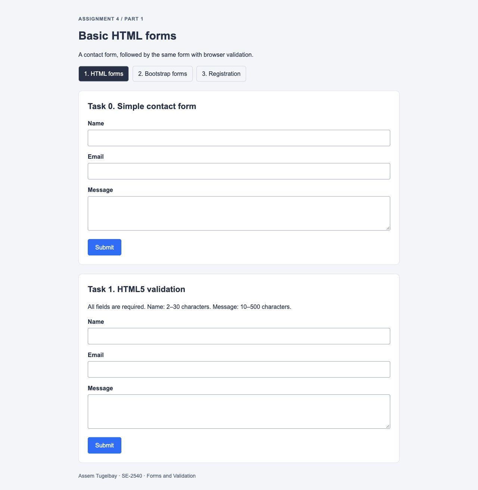
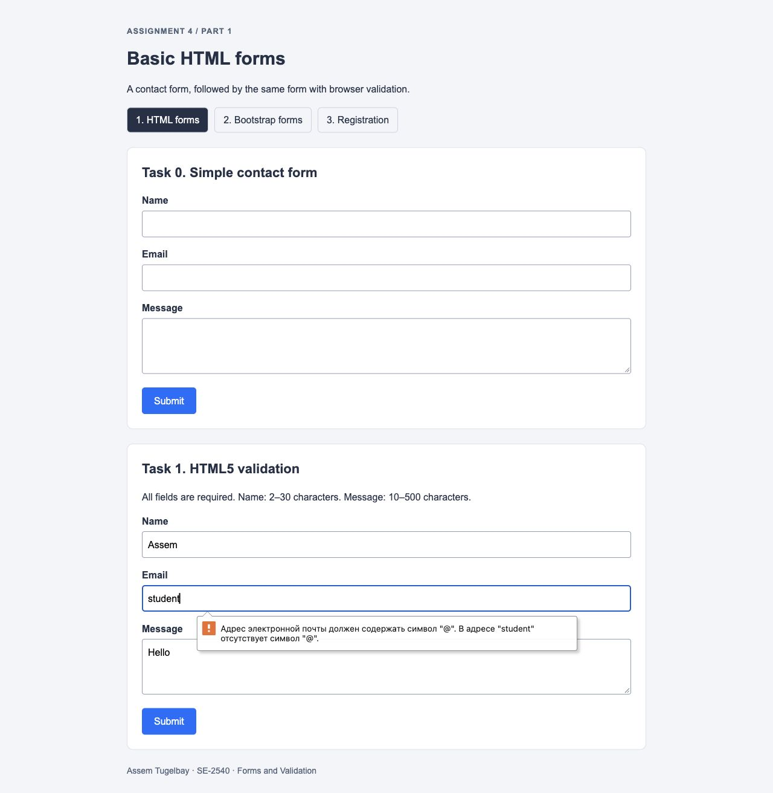
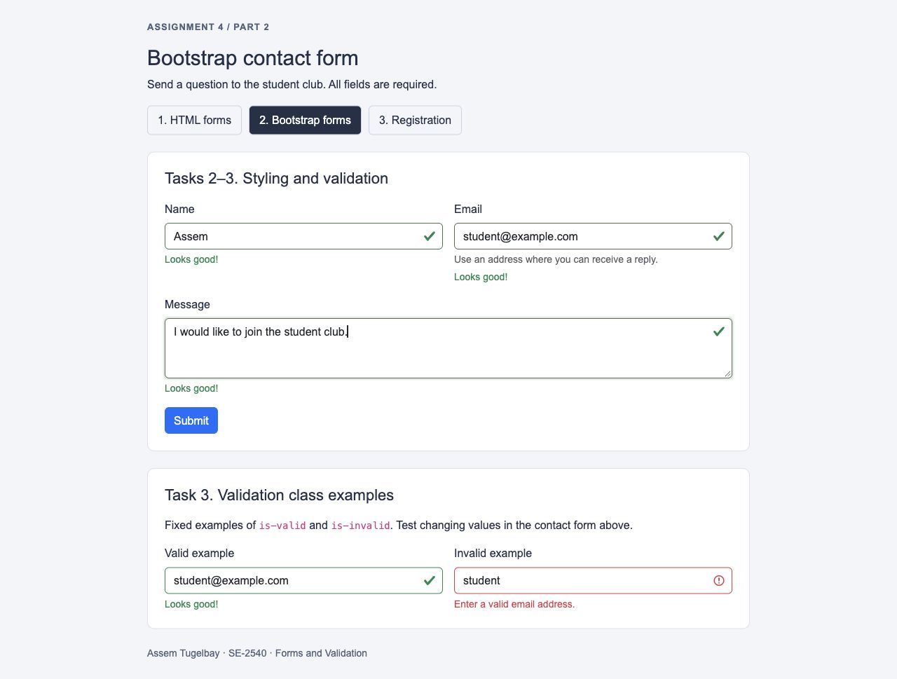
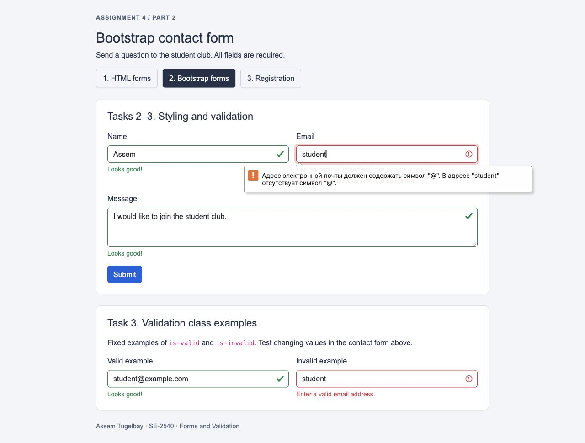
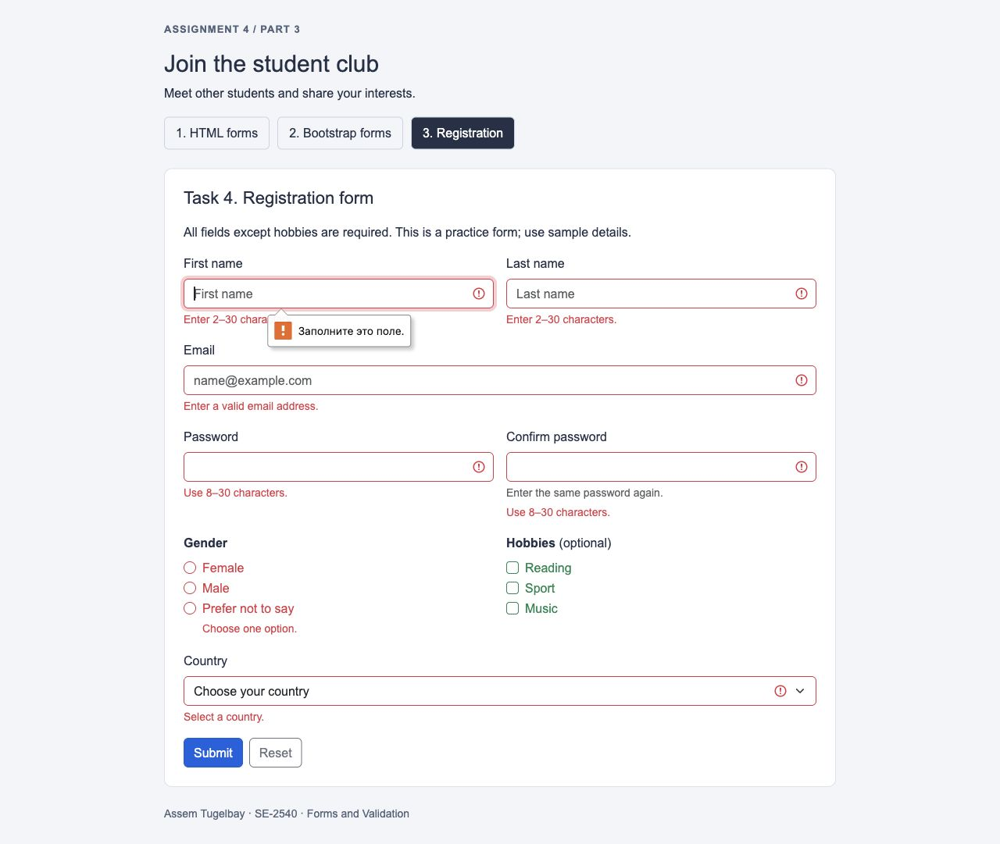
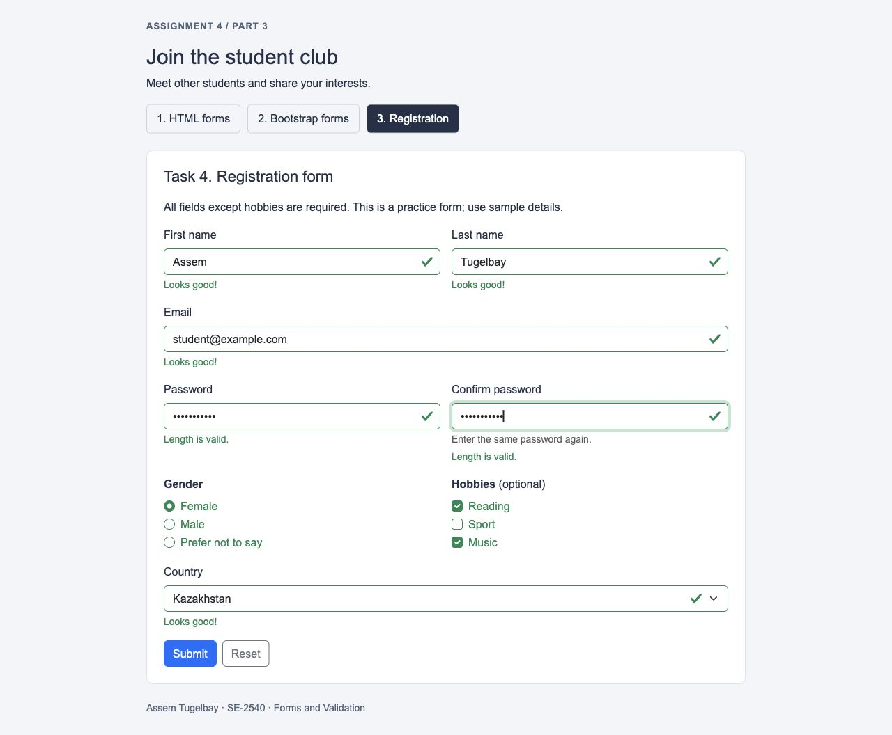
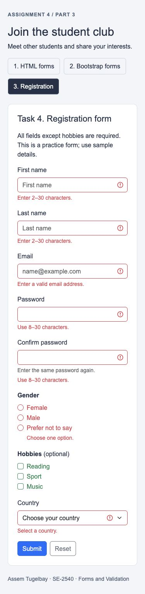

# Assignment 4 — Forms and Validation

**Student:** Assem Tugelbay  
**Group:** SE-2540  
**Course:** Web Technologies I (Front End)

**Repository:** [asemtygelbaeva-byte/assignment4_frontend](https://github.com/asemtygelbaeva-byte/assignment4_frontend)

A small student club project using **HTML5, basic CSS and Bootstrap 5.3.8 CSS only**. There are no JavaScript files, script tags, event handlers, frameworks, packages to install or build commands.

## Run the project

Download the repository and open `index.html` in a browser. Use the three navigation links to visit every part. An internet connection is required for the Bootstrap stylesheet. The basic HTML page uses only the local stylesheet.

| File | Purpose |
| --- | --- |
| `basic.html` | Part 1: Tasks 0 and 1 |
| `bootstrap.html` | Part 2: Tasks 2 and 3 |
| `index.html` | Part 3: Task 4 |
| `styles.css` | Shared appearance and basic form styling |
| `complete.html` | Destination after a permitted form submission |
| `DEFENSE_RU.md` | Russian explanation and practice questions |
| `screenshots/` | Screenshots for every task |

## Part 1 — Basic HTML Forms

### Task 0 — Simple Contact Form

The first form in `basic.html` contains a name input, email input, message textarea and Submit button. Each label's `for` matches its input's `id`. This initial form does not require values; `type="email"` still checks a nonempty email address.

### Task 1 — Form with HTML5 Validation

The second form adds `required`, `minlength` and `maxlength`. The name accepts 2–30 characters, the message accepts 10–500, and `type="email"` checks email syntax. The browser blocks invalid submissions and focuses the first invalid field. No `novalidate` attribute is used.

## Part 2 — Bootstrap Forms

### Task 2 — Bootstrap Form Styling

`bootstrap.html` recreates the contact form using `form-label`, `form-control`, `form-text` and `btn`. The `row g-3` grid creates spacing. Two `col-md-6` columns place the name and email side by side from 768px; smaller screens stack them. The message occupies `col-12`. Placeholders provide examples and helper text explains the email field.

### Task 3 — Bootstrap Validation Styles

The contact form uses a permanent `was-validated` class. Bootstrap CSS reacts to the browser's `:valid` and `:invalid` states and displays `valid-feedback` or `invalid-feedback`. Feedback is visible from the beginning and changes as values change. Browser validation remains enabled.

Two separate, read-only examples explicitly demonstrate the requested `is-valid` and `is-invalid` classes. These are fixed styling examples, not automatic validators. The editable contact form above them provides the working validation test.

## Part 3 — Advanced Form Project

### Task 4 — Registration Form

`index.html` includes first name, last name, email, password, confirm password, gender radio buttons, hobby checkboxes, a country dropdown, and Submit and Reset buttons. Related options use `fieldset` and `legend`. Gender radios share a `name`, so only one is selectable; multiple hobbies can be selected.

Names require 2–30 characters. Email must have valid syntax. Both password fields require 8–30 characters. Gender and country are required; hobbies are optional. Bootstrap Grid handles responsiveness, and feedback explains errors and successful field checks.

## Scope and limitations

The syllabus places HTML forms in week 2, CSS in weeks 3–4 and Bootstrap in week 5. Week 6 introduces basic JavaScript expressions and conditions; DOM, events and JavaScript form validation are later topics. This assignment therefore uses HTML validation and Bootstrap CSS without JavaScript.

- `was-validated` is present from page load, so empty required fields initially appear red. Reset returns the form to this empty state.
- HTML can check each password's length but cannot compare the values of two different inputs. The confirmation field does **not** automatically check equality. Its green message says “Length is valid”, not “Passwords match”.
- This is a frontend demonstration: no backend, database, email delivery or real account creation is implemented. A valid submission opens `complete.html` using GET. Named fields appear in the URL. Password fields intentionally have no `name`, so passwords are excluded from the URL. Use sample details.

## Test results

| Check | Observed result |
| --- | --- |
| Empty required fields | Browser blocks submission and focuses the first invalid field |
| Email `student` | Rejected; corrected `student@example.com` is accepted |
| Five-character message | Rejected by the 10-character minimum when typed |
| Three-character password | Rejected by the 8-character minimum when typed |
| Valid contact and registration fields | Feedback turns green; Submit opens the demo completion page |
| Reset | Text inputs, country, radios and checkboxes return to their initial values |
| Registration submission URL | Passwords are absent |
| Mobile widths 320px and 375px | No horizontal overflow; columns stack |
| Project script check | No scripts on any page |

## Work process summary

The project was prepared by checking the assignment tasks and the syllabus boundary, building the basic forms, adding HTML constraints, applying Bootstrap's grid and feedback classes, and testing valid and invalid inputs in a browser. Screenshots document the implemented tasks. The design uses one small stylesheet and the same navigation on each page.

## Resources and assistance

- [Bootstrap form overview](https://getbootstrap.com/docs/5.3/forms/overview/)
- [Bootstrap validation](https://getbootstrap.com/docs/5.3/forms/validation/)
- [Bootstrap Grid](https://getbootstrap.com/docs/5.3/layout/grid/)
- [HTML form attributes](https://www.w3schools.com/html/html_form_attributes.asp)
- Course assignment brief and syllabus, supplied by the instructor.

**AI assistance disclosure:** ChatGPT assisted with the initial code, debugging, browser checks, documentation and explanations. The student is responsible for reviewing and adapting the work and explaining it during the required defense.
